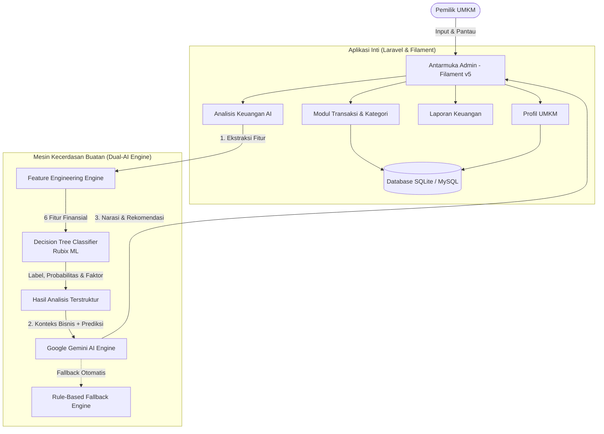
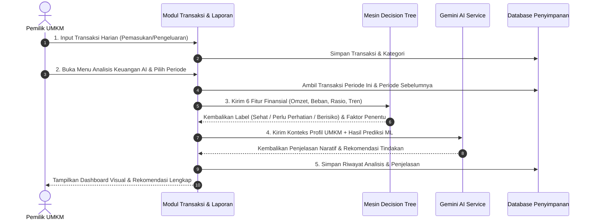

# 📘 Panduan & Cara Kerja Sistem Manajemen Keuangan Berbasis AI (UMKM Finance Intelligence)

Sistem ini adalah platform manajemen keuangan cerdas yang dirancang khusus untuk membantu pelaku **Usaha Mikro, Kecil, dan Menengah (UMKM)** mencatat transaksi keuangan secara terstruktur, mengevaluasi kesehatan finansial menggunakan **Machine Learning (Decision Tree)**, serta memperoleh interpretasi dan rekomendasi bisnis yang aplikatif melalui **Generative AI (Google Gemini)**.

---

## 🏛️ 1. Arsitektur & Teknologi Sistem



### Komponen Teknologi:
- **Framework Utama:** Laravel 12/13 (PHP 8.5)
- **Panel Admin & Antarmuka:** Filament v5 (Livewire 3 & Alpine.js)
- **Database ORM:** SQLite / MySQL dengan Eloquent ORM & isolasi multi-user (`user_id` query scoping)
- **Machine Learning (Decision Tree):** Rubix ML (PHP Machine Learning Engine)
- **Generative AI:** Google Gemini API (`gemini-1.5-flash` / `gemini-pro`) dengan sistem cadangan *rule-based fallback*

---

## 🔄 2. Alur Kerja Sistem (End-to-End Workflow)

Proses operasional sistem terbagi menjadi **5 tahapan utama**:



---

## ⚙️ 3. Penjelasan Rinci Modul & Komponen

### A. Modul Operasional & Transaksi
1. **Profil UMKM (`/admin/business-profile-page`)**
   - Menyimpan identitas usaha: nama usaha, bidang usaha (Kuliner, Retail, Jasa, dll.), modal awal, nomor telepon, dan deskripsi produk/pelanggan.
   - Data ini menjadi **konteks primer** bagi Gemini AI dalam menyusun rekomendasi yang relevan (misal: strategi untuk usaha kuliner berbeda dengan usaha retail/jasa).
2. **Kategori Transaksi (`/admin/transaction-categories`)**
   - Menstandarkan pos pemasukan (*Penjualan Produk*, *Katering/Jasa*, *Investasi Masuk*) dan pos pengeluaran (*Bahan Baku*, *Gaji Karyawan*, *Sewa & Utilitas*, *Pemasaran*, dll.).
3. **Pencatatan Transaksi (`/admin/transactions`)**
   - Pencatatan buku kas harian secara cepat: jenis (pemasukan/pengeluaran), tanggal, nominal, kategori, dan keterangan.
   - Dilengkapi filter pencarian berdasarkan tanggal dan kategori.

---

### B. Modul Laporan & Visualisasi (`/admin/financial-report-page`)
- **Filter Fleksibel:** Tombol periode cepat (*Hari Ini*, *Bulan Ini*, *Bulan Lalu*, *Tahun Ini*) serta pemilih tanggal kustom.
- **4 Kartu Metrik Utama (KPI):**
  - **Total Pemasukan:** Akumulasi arus kas masuk.
  - **Total Pengeluaran:** Akumulasi belanja modal & operasional.
  - **Arus Kas Bersih (*Net Cash Flow*):** Selisih pemasukan - pengeluaran dengan indikator surplus/defisit.
  - **Rasio Pengeluaran (*Expense Ratio*):** Persentase beban terhadap pendapatan dengan status efisiensi.
- **Rekapitulasi per Kategori:** Menganalisis pos mana yang paling dominan dalam menyerap anggaran atau menyumbang omzet.
- **Rincian Transaksi & Ekspor:** Rekam kronologis transaksi dengan fitur unduh data ke format **CSV**.

---

### C. Mesin Machine Learning: Decision Tree Classifier
Sistem menggunakan model **Decision Tree** murni untuk menentukan status kesehatan keuangan.

#### 1. Ekstraksi Fitur (*Feature Engineering*)
Model membaca 6 parameter kuantitatif dari data transaksi:

| Fitur | Definisi | Rumus / Cara Perhitungan |
| :--- | :--- | :--- |
| `total_income` | Total pemasukan periode berjalan | $\sum \text{Pemasukan}$ |
| `total_expense` | Total pengeluaran periode berjalan | $\sum \text{Pengeluaran}$ |
| `net_cash_flow` | Arus kas bersih | $\text{total\_income} - \text{total\_expense}$ |
| `expense_ratio` | Rasio beban terhadap pendapatan | $\text{total\_expense} / \text{total\_income}$ |
| `income_trend` | Pertumbuhan pendapatan dibanding periode lalu | $(\text{Income}_{\text{ini}} - \text{Income}_{\text{lalu}}) / \text{Income}_{\text{lalu}}$ |
| `cash_flow_trend` | Perubahan arus kas dibanding periode lalu | $(\text{Net}_{\text{ini}} - \text{Net}_{\text{lalu}}) / \|\text{Net}_{\text{lalu}}\|$ |

#### 2. Kategori Hasil Klasifikasi
- 🟢 **Sehat (*Healthy*):** Arus kas positif, rasio pengeluaran efisien ($\le 70\%$), dan tren pendapatan bertumbuh stabil.
- 🟡 **Perlu Perhatian (*Warning*):** Arus kas tipis, rasio beban tinggi ($71\% - 90\%$), atau terjadi penurunan omzet.
- 🔴 **Berisiko (*At Risk*):** Defisit kas (pengeluaran melampaui pendapatan) atau rasio beban $> 90\%$.

#### 3. Keunggulan Decision Tree untuk Keuangan
- **Transparan & *Explainable*:** Tidak berupa *black-box*. Aturan keputusan (*if-then rules*) dapat dilacak kembali ke faktor penentunya.
- **Deterministik:** Memberikan hasil yang konsisten berdasarkan metrik akuntansi yang teruji.

---

### D. Mesin Generative AI (Google Gemini)
Model bahasa besar (LLM) **tidak bertugas menghitung angka**, melainkan menerjemahkan data matematis menjadi bahasa manusia yang bersahabat:

1. **Input yang Diterima Gemini:**
   - Profil UMKM (Jenis usaha, deskripsi, skala modal).
   - Metrik angka keuangan yang sudah dihitung sistem.
   - Hasil keputusan model Machine Learning beserta probabilitas dan faktor kuncinya.
2. **Output yang Dihasilkan Gemini:**
   - **Narasi Penjelasan:** Uraian kondisi keuangan tanpa jargon rumit.
   - **Daftar Rekomendasi Konkret:** Langkah praktis pemotongan biaya, penyesuaian harga jual, manajemen stok, atau strategi promosi yang spesifik untuk jenis usaha tersebut.
3. **Mekanisme *Fallback* Otomatis:**
   - Jika kuota API Gemini habis atau koneksi internet bermasalah, sistem secara mulus beralih ke **Rule-Based Engine** bawaan, sehingga aplikasi tidak pernah *crash* dan pengguna tetap memperoleh analisis.

---

## 🔒 4. Keamanan & Isolasi Data (*Multi-Tenancy*)

- Setiap transaksi, kategori, profil usaha, dan hasil analisis AI terikat secara ketat pada `user_id` pemilik akun.
- Seluruh query Eloquent dilindungi oleh *Global Scope* / *Query Constraints*:
  ```php
  Transaction::where('user_id', auth()->id())->get();
  ```
- Pemilik usaha tidak dapat melihat atau mengakses data keuangan milik UMKM lain.

---

## 💡 5. Panduan Singkat Menjalankan Analisis

1. Masuk ke halaman **Transaksi** (`/admin/transactions`), masukkan minimal 5-10 transaksi pemasukan dan pengeluaran.
2. Pastikan **Profil UMKM** (`/admin/business-profile-page`) telah dilengkapi jenis usaha dan nama brand.
3. Buka menu **Laporan & Analisis AI** ➔ **Analisis Keuangan AI** (`/admin/financial-analyses`).
4. Klik tombol **"Jalankan Analisis AI"** di kanan atas.
5. Tentukan rentang periode (misal: Bulan Ini), lalu klik **Simpan**.
6. Sistem akan memproses algoritma Decision Tree dan Gemini AI dalam 1-3 detik, kemudian menyajikan laporan diagnosa kesehatan finansial lengkap dengan rekomendasi langkah perbaikannya.
