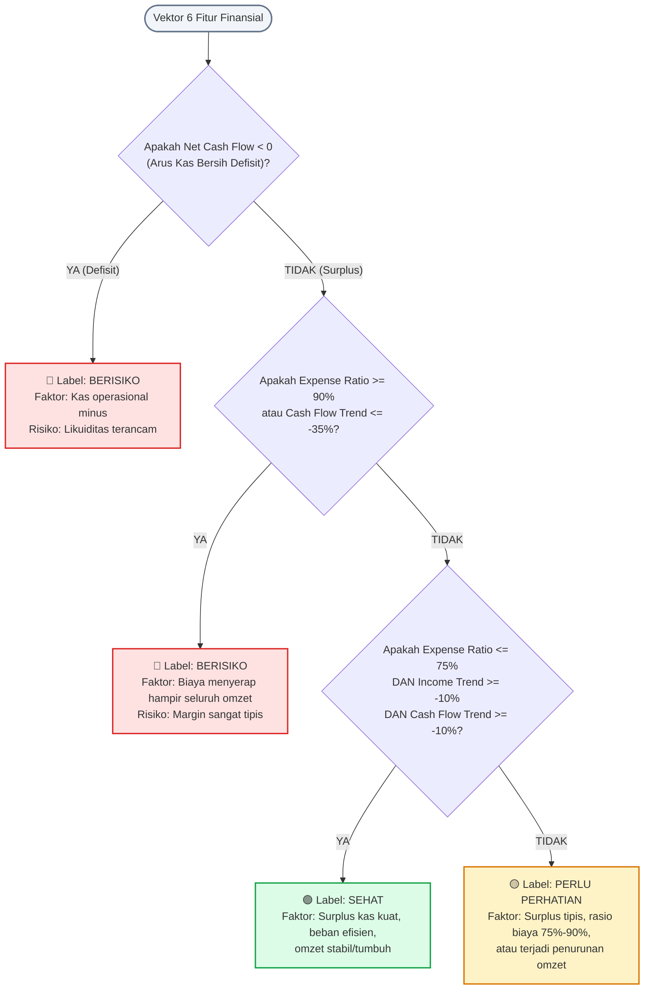

# 🌳 Penjelasan Lengkap Model Machine Learning: Decision Tree

Dokumen ini menjelaskan secara rinci cara kerja, arsitektur, parameter, logika percabangan, serta alur pelatihan dan inferensi dari algoritma **Decision Tree (Pohon Keputusan)** yang diimplementasikan pada **Sistem Manajemen Keuangan UMKM**.

---

## 🎯 1. Mengapa Memilih Decision Tree?

Dalam sistem penilaian kesehatan keuangan bisnis/UMKM, algoritma **Decision Tree** dipilih dibandingkan model lain (seperti *Neural Network* atau *Black-Box Models*) karena keunggulan-keunggulan berikut:

| Karakteristik | Decision Tree | Neural Network / Deep Learning |
| :--- | :--- | :--- |
| **Sifat Model** | **White-Box** (Transparan & dapat diaudit) | **Black-Box** (Sulit dipahami alasannya) |
| **Kesesuaian Domain** | Sangat cocok untuk ambang batas keuangan (*financial thresholds*) | Membutuhkan jutaan data & sulit diverifikasi akuntansinya |
| **Kecepatan Inferensi** | Instan (< 5 milidetik) | Membutuhkan GPU/resource komputasi tinggi |
| **Keterjelasan (*Explainability*)** | Faktor penentu keputusan dapat dilacak secara eksplisit | Bobot tersembunyi antar-lapisan (*hidden layers*) |

---

## 🏗️ 2. Arsitektur & Teknologi

Model Decision Tree pada sistem ini diimplementasikan secara murni (*native*) di dalam lingkungan PHP menggunakan pustaka machine learning **Rubix ML**:

- **File Service Utama:** [`app/Services/ML/FinancialDecisionTreeService.php`](file:///c:/Users/Software%20Enginer/Documents/simkeuangan/Sistem-Manajemen-Keuangan-Berbasis-AI/app/Services/ML/FinancialDecisionTreeService.php)
- **Generator Dataset & Pelabelan:** [`app/Services/ML/DatasetGenerator.php`](file:///c:/Users/Software%20Enginer/Documents/simkeuangan/Sistem-Manajemen-Keuangan-Berbasis-AI/app/Services/ML/DatasetGenerator.php)
- **Artisan Console Command:** [`app/Console/Commands/TrainDecisionTreeCommand.php`](file:///c:/Users/Software%20Enginer/Documents/simkeuangan/Sistem-Manajemen-Keuangan-Berbasis-AI/app/Console/Commands/TrainDecisionTreeCommand.php)
- **Model Tersimpan (*Persistent Model*):** `storage/app/ml/decision_tree.model`

### Konfigurasi Hyperparameter Model
```php
$tree = new ClassificationTree(
    maxHeight: 10,           // Kedalaman maksimum pohon
    maxLeafSize: 5,          // Jumlah sampel minimum pada daun akhir
    minPurityIncrease: 1e-4  // Ambang batas peningkatan Gini Impurity
);
```

1. **`maxHeight = 10`**: Membatasi kedalaman percabangan agar model tidak menghafal data latihan (*mencegah overfitting*).
2. **`maxLeafSize = 5`**: Menjaga kestabilan estimasi probabilitas pada setiap daun (*leaf node*).
3. **`minPurityIncrease = 1e-4`**: Pohon hanya akan membelah (*split*) jika pembelahan tersebut benar-benar meningkatkan homogenitas data.

---

## 📊 3. Vektor Fitur Keuangan (*Feature Engineering*)

Sebelum model mengambil keputusan, sistem mengekstrak **6 fitur numerik** dari rekapitulasi data transaksi:

```mermaid
graph LR
    subgraph Data Transaksi Riil
        Tx1[Pemasukan Periode Aktif]
        Tx2[Pengeluaran Periode Aktif]
        Tx3[Pemasukan Periode Sebelumnya]
        Tx4[Pengeluaran Periode Sebelumnya]
    end

    Data Transaksi Riil --> Engine[Feature Extraction Engine]

    subgraph 6 Fitur Masukan Decision Tree
        Engine --> F1[1. total_income]
        Engine --> F2[2. total_expense]
        Engine --> F3[3. net_cash_flow]
        Engine --> F4[4. expense_ratio]
        Engine --> F5[5. income_trend]
        Engine --> F6[6. cash_flow_trend]
    end
```

### Tabel Rincian Fitur:

| No | Nama Fitur | Definisi Akuntansi | Rumus Matematis |
| :---: | :--- | :--- | :--- |
| **1** | `total_income` | Akumulasi kas masuk periode aktif | $\sum \text{Transaksi Pemasukan}$ |
| **2** | `total_expense` | Akumulasi beban keluar periode aktif | $\sum \text{Transaksi Pengeluaran}$ |
| **3** | `net_cash_flow` | Arus kas operasional bersih | $\text{total\_income} - \text{total\_expense}$ |
| **4** | `expense_ratio` | Rasio penyerapan beban terhadap omzet | $\frac{\text{total\_expense}}{\text{total\_income}}$ |
| **5** | `income_trend` | Pertumbuhan pendapatan vs periode lalu | $\frac{\text{Income}_{\text{ini}} - \text{Income}_{\text{lalu}}}{\text{Income}_{\text{lalu}}}$ |
| **6** | `cash_flow_trend` | Pertumbuhan likuiditas kas vs periode lalu | $\frac{\text{Net}_{\text{ini}} - \text{Net}_{\text{lalu}}}{\|\text{Net}_{\text{lalu}}\|}$ |

---

## 🌳 4. Diagram Pohon Keputusan (*Decision Tree Flowchart*)

Berikut visualisasi diagram alur logika yang dipelajari dan dieksekusi oleh model Decision Tree:



---

## 📈 5. Kategori Hasil Klasifikasi

1. 🟢 **Sehat (*Healthy*):**
   - Arus kas positif (*surplus*).
   - Rasio pengeluaran efisien ($\le 75\%$).
   - Tren pendapatan dan likuiditas kas stabil atau bertumbuh positif.
   - Usaha memiliki daya tahan (*buffer*) kas yang aman untuk operasional ke depan.

2. 🟡 **Perlu Perhatian (*Warning*):**
   - Arus kas masih positif, namun margin laba mulai menipis ($75\% < \text{rasio beban} < 90\%$).
   - Mulai terjadi tren perlambatan atau penurunan omzet.
   - Usaha rentan mengalami defisit jika ada pengeluaran tak terduga.

3. 🔴 **Berisiko (*At Risk*):**
   - Arus kas operasional negatif (pengeluaran melampaui pemasukan).
   - Rasio pengeluaran kritis ($\ge 90\%$ atau bahkan $> 100\%$).
   - Tren likuiditas kas anjlok drastis ($<-35\%$).
   - Usaha berpotensi mengalami krisis likuiditas / gagal bayar kewajiban operasional.

---

## 🧪 6. Pelatihan & Evaluasi Model (*Training Pipeline*)

Model dilatih menggunakan dataset sintetis berbasis pola operasional UMKM yang realistis:

```bash
php artisan ml:train-decision-tree --samples=5000
```

### Prosedur Pelatihan:
1. **Pembangkitan Sampel (5.000 Data):**
   Mencakup rentang omzet Rp 3.000.000 hingga Rp 150.000.000 dengan simulasi variasi beban dan fluktuasi riil UMKM.
2. **Pemisahan Data (*Train-Test Split* 80:20):**
   - **80% (4.000 sampel, stratified):** Digunakan untuk melatih algoritma Decision Tree.
   - **20% (1.000 sampel):** Disimpan terpisah sebagai *testing set* untuk menguji akurasi model pada data yang belum pernah dilihat sebelumnya (*out-of-sample evaluation*).
3. **Metrik Evaluasi yang Dipantau:**
   - **Accuracy:** Persentase ketepatan prediksi keseluruhan.
   - **Precision & Recall:** Mengukur keandalan klasifikasi per kategori (Sehat, Perlu Perhatian, Berisiko) guna menghindari *false negative* pada kondisi berisiko.
   - **Confusion Matrix:** Matriks persebaran prediksi model vs data sebenarnya.

---

## 🤝 7. Integrasi Decision Tree dengan Gemini AI

Decision Tree dan Large Language Model (Gemini) bekerja dalam konsep **Dual-AI Engine** dengan pembagian peran yang sangat tegas:

```
[Transaksi Keuangan]
        │
        ▼
[Ekstraksi 6 Fitur]
        │
        ▼
[Decision Tree ML] ──> Menghasilkan fakta matematis:
                        - Status: "Sehat"
                        - Confidence: 96,3% (terkalibrasi, maks. 98,67%)
                        - Faktor: "Surplus kas Rp 11.100.000, Rasio beban 57%"
        │
        ▼
[Google Gemini AI] ──> Menerima fakta matematis + Konteks Profil UMKM
                        Menghasilkan narasi konsultasi bisnis yang komunikatif:
                        - Penjelasan kondisi keuangan tanpa jargon rumit.
                        - 3-5 butir rekomendasi taktis bisnis yang aplikatif.
```

Dengan arsitektur ini:
- **Angka keuangan tidak pernah dihalusinasi oleh AI**, karena seluruh metrik dan vonis status kesehatan dikendalikan penuh oleh algoritma matematis Decision Tree.
- **Gemini AI** fokus pada apa yang paling dikuasainya: menyusun penjelasan bahasa manusia yang ramah, memotivasi, dan mudah dipahami pemilik UMKM.
