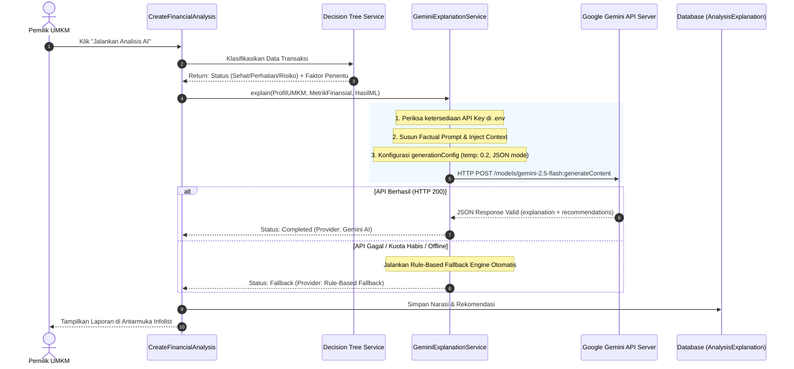

# 🤖 Penjelasan Cara Kerja Large Language Model (Google Gemini AI)

Dokumen ini menjelaskan secara komprehensif arsitektur, peran, alur kerja, struktur *prompt*, mekanisme anti-halusinasi, serta sistem *fallback* dari modul **Large Language Model (LLM)** yang diimplementasikan pada **Sistem Manajemen Keuangan UMKM**.

---

## 🎯 1. Filosofi & Batasan Peran LLM

Pada aplikasi ini, peran LLM (Google Gemini) dibatasi dengan **prinsip pemisahan tanggung jawab (*separation of concerns*) yang sangat ketat**:

```
┌─────────────────────────────────────────────────────────┐
│                    DILARANG KERAS:                      │
│ ❌ Menghitung ulang saldo, laba rugi, atau rasio kas    │
│ ❌ Mengarang angka atau membuat asumsi finansial liar    │
│ ❌ Mengubah atau menganulir vonis Decision Tree         │
└─────────────────────────────────────────────────────────┘
                            ▲
                            │
┌─────────────────────────────────────────────────────────┐
│                    TUGAS UTAMA LLM:                     │
│ ✅ Mengubah data angka menjadi narasi yang manusiawi     │
│ ✅ Menerjemahkan istilah teknis ke bahasa pemilik UMKM   │
│ ✅ Memberikan rekomendasi taktis bisnis yang relevan     │
└─────────────────────────────────────────────────────────┘
```

> **Prinsip Utama:** *Decision Tree bertindak sebagai Hakim Matematis yang menetapkan vonis kesehatan finansial, sementara Gemini AI bertindak sebagai Konsultan Bisnis yang mengomunikasikannya dengan empati dan bahasa yang mudah dipahami.*

---

## 🏗️ 2. Arsitektur & Spesifikasi Teknis

- **File Service Utama:** [`app/Services/AI/GeminiExplanationService.php`](file:///c:/Users/Software%20Enginer/Documents/simkeuangan/Sistem-Manajemen-Keuangan-Berbasis-AI/app/Services/AI/GeminiExplanationService.php)
- **Model Penyimpanan Narasi:** [`app/Models/AnalysisExplanation.php`](file:///c:/Users/Software%20Enginer/Documents/simkeuangan/Sistem-Manajemen-Keuangan-Berbasis-AI/app/Models/AnalysisExplanation.php)
- **Penyedia AI:** Google Gemini API (`https://generativelanguage.googleapis.com/v1beta`)
- **Versi Model Default:** `gemini-2.5-flash` / `gemini-1.5-flash` (cepat, hemat kuota, dan mendukung *Structured Outputs*).

---

## 🔄 3. Alur Kerja LLM (Step-by-Step Flow)



---

## 📝 4. Rekayasa Prompt (*Prompt Engineering*) & Injeksi Konteks

Prompt dibangun secara dinamis di dalam metode `buildPrompt()` dengan menyatukan 3 dimensi data:

1. **Dimensi Konteks Usaha:** Nama brand dan kategori bidang usaha (F&B, Retail, Jasa, dll.).
2. **Dimensi Kuantitatif Riil:** Omzet pemasukan, beban operasional, arus kas bersih, dan rasio beban.
3. **Dimensi Diagnosa ML:** Label keputusan Decision Tree beserta faktor-faktor pemicunya.

### Template Prompt Asli pada Sistem:
```text
Anda adalah asisten konsultan keuangan cerdas untuk UMKM Indonesia.
Tugas Anda adalah menjelaskan hasil klasifikasi model Machine Learning (Decision Tree) ke dalam bahasa yang mudah dipahami, simpatik, edukatif, dan profesional bagi pemilik usaha.

ATURAN KETAT:
1. DILARANG MENGARANG angka atau fakta baru. Gunakan hanya data finansial yang diberikan di bawah.
2. Hasil klasifikasi model Decision Tree ADALAH FINAL. Anda bertugas MENJELASKAN MENGAPA model memberi label tersebut, bukan mengubah labelnya.
3. Berikan output dalam format JSON valid dengan struktur:
{
  "explanation": "Teks penjelasan naratif (1-2 paragraf padat dan jelas)",
  "recommendations": [
    "Poin rekomendasi 1",
    "Poin rekomendasi 2",
    "Poin rekomendasi 3"
  ]
}

DATA SUMBER:
- Nama Usaha: Kedai Kopi Berkah
- Bidang Usaha: Kuliner & Makanan / Minuman (F&B)
- Total Pemasukan: Rp 25.800.000
- Total Pengeluaran: Rp 14.700.000
- Arus Kas Bersih (Net Cash Flow): Rp 11.100.000
- Rasio Pengeluaran: 57.0%
- Perubahan Pemasukan (Tren): +49.1%
- Klasifikasi Model Decision Tree: Sehat (Confidence: 1.0)
- Faktor Kunci Penentu Model: Arus kas operasional positif (surplus Rp 11.100.000); Rasio pengeluaran efisien (57.0%)
```

---

## 🛡️ 5. Mekanisme Anti-Halusinasi & Penjamin Kualitas

Untuk memastikan keluaran LLM selalu akurat dan tidak melenceng, sistem menerapkan 3 lapis perlindungan:

1. **Temperatur Sangat Rendah (`temperature: 0.2`):**
   Nilai temperatur mendekati nol membuat model bersikap deterministik, fokus pada data fakta yang disajikan, dan mencegah model berimajinasi secara puitis/liar.
2. **Struktur Keluaran Terkunci (*Structured JSON Output*):**
   ```php
   'generationConfig' => [
       'responseMimeType' => 'application/json',
       'temperature' => 0.2,
   ]
   ```
   Fitur bawaan Gemini API ini memaksa AI membalas langsung dalam format JSON tanpa ada teks pengantar seperti *"Tentu, ini hasil analisisnya:"* atau pembungkus markdown ```json ``` yang rawan gagal dibaca (*parse error*).
3. **Penyaringan JSON (*JSON Decoder & Validation*):**
   Sebelum disimpan ke database, respon didekode menggunakan `json_decode($candidates, true)`. Sistem memastikan bahwa elemen `explanation` dan array `recommendations` benar-benar ada dan tidak kosong.

---

## 🛟 6. Sistem Cadangan Otomatis (*Rule-Based Fallback Engine*)

Aplikasi bisnis tidak boleh berhenti beroperasi (*crash*) hanya karena gangguan pihak ketiga (misalnya kuota harian Gemini habis, jaringan internet lemot, atau API key belum disetel). 

Metode `generateFallbackExplanation()` dirancang untuk mendeteksi kegagalan tersebut dan seketika beralih ke mesin pembuat narasi berbasis aturan akuntansi baku (*rule-based*):

| Kondisi Sistem | Sumber Penjelasan | Label Provider di UI |
| :--- | :--- | :--- |
| **API Key Valid & Internet Lancar** | Google Gemini API | 🔵 `Gemini AI` |
| **API Key Kosong / Kuota Habis (429) / Timeout** | Rule-Based Fallback Engine | 🟡 `Aturan Otomatis (Fallback)` |

### Contoh Narasi yang Dihasilkan Fallback:
- **Untuk Status Sehat:** *"Berdasarkan evaluasi algoritma Decision Tree, kondisi keuangan Toko Berkah Jaya pada periode ini tergolong SEHAT. Usaha berhasil mencatatkan surplus kas bersih sebesar Rp 11.100.000 dengan rasio beban 57.0%..."*
- **Rekomendasi Otomatis:** Menyarankan alokasi 10-20% surplus kas ke pos cadangan darurat (*emergency reserve*) dan mempertahankan efisiensi harga pokok penjualan.

---

## 📊 7. Struktur Data Penyimpanan Database

Hasil penjelasan disimpan ke tabel `analysis_explanations` yang berelasi `hasOne` dengan `financial_analyses`:

| Kolom Database | Tipe Data | Keterangan |
| :--- | :--- | :--- |
| `financial_analysis_id` | Foreign Key (ID) | Terhubung ke hasil perhitungan & Decision Tree |
| `explanation` | Text / LongText | Narasi komprehensif kondisi keuangan |
| `recommendations` | JSON (Array string) | Butir-butir poin tindakan perbaikan bisnis |
| `provider` | String | `gemini-api` atau `rule-based-engine` |
| `status` | String | `completed` atau `fallback` |

Tampilan riwayat ini dapat dilihat kapan saja oleh pemilik UMKM pada halaman [**Analisis Keuangan AI**](http://localhost:8000/admin/financial-analyses).
